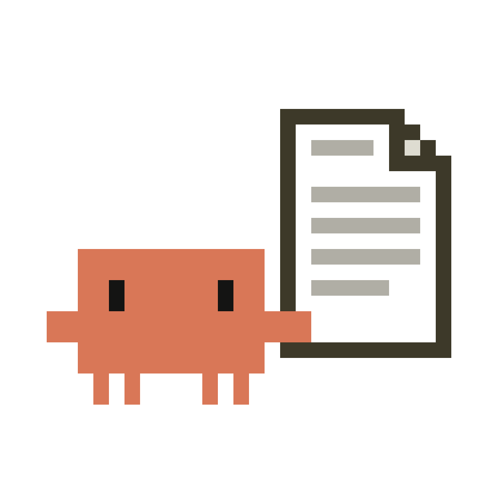

<p align="center">
  
</p>

# scratchpad-finder

A Claude Code mod that makes the scratchpad easy to find. Claude often saves
files to a per-session scratchpad folder buried deep in your temp directory.
This mod tells you when that happens and gives you one-step ways to open,
show or copy those files on macOS, Windows and Linux.

## What it does

- **Save notice.** When Claude writes or edits a file in the scratchpad, a
  toast says so, and the file's full path goes on your clipboard.
- **`/scratchpad` command.**

  | Command | Does |
  | --- | --- |
  | `/scratchpad` | Opens the side pane and lists the files |
  | `/scratchpad list` | Lists the files, newest first |
  | `/scratchpad open [file]` | Opens the file in its default app, or the folder |
  | `/scratchpad reveal [file]` | Shows the file (or the folder) in Finder / Explorer / your file manager |
  | `/scratchpad copy [file]` | Copies the file's (or the folder's) full path |

  `[file]` can be part of a name: `/scratchpad open report` finds `report.md`.
- **Side pane.** Lists the scratchpad's files with **Open**, **Show in folder**
  and **Copy path** buttons. It updates after every tool call.

## Install

The repository is private: you need read access to it on GitHub, and a git
credential for github.com on your machine (an SSH key, or `gh auth login`
then `gh auth setup-git`).

At the prompt of a Claude Code terminal session:

```
/plugin install scratchpad-finder --marketplace nazareneism/scratchpad-finder
```

Answer `y` to add the marketplace, then pick a scope (user is first).

From a shell:

```
claude plugin install scratchpad-finder --marketplace nazareneism/scratchpad-finder
```

In the desktop app: click + next to the prompt box, then Plugins, Add
marketplace with `nazareneism/scratchpad-finder`, then Add plugin.

While developing, load it straight from a clone:

```
claude --plugin-dir /path/to/scratchpad-finder
```

## Settings

| Option | Default | Meaning |
| --- | --- | --- |
| `autoCopy` | `true` | Copy a file's path to the clipboard when Claude saves it to the scratchpad. |

Change it in `/config` or under `pluginConfigs.scratchpad-finder.options`
in `~/.claude/settings.json`.

## Platform notes

| Platform | Open | Show in folder |
| --- | --- | --- |
| macOS | `open` | `open -R` (selects the file in Finder) |
| Windows | `explorer.exe` | `explorer.exe /select,` |
| Linux | `xdg-open` | `xdg-open` on the containing folder |

In a cloud session the scratchpad lives in the remote container, so Open
and Show in folder can't reach your computer. Copy path and the list still work.

## Layout

```
.claude-plugin/plugin.json   manifest and the autoCopy option
.claude-plugin/marketplace.json  lets the repo be installed from directly
.claude-plugin/icon.png      plugin icon, drawn by assets/make_logo.py
hooks/hooks.json             names the hooks module
hooks/register.ts            wires features to events, nothing else
hooks/core/                  pure helpers: paths, formatting, platform table
hooks/services/              shared $-using code: state, locating, listing, actions
hooks/features/              notify (save toast), command, pane
types/index.d.ts             the $.state contract
tests/                       unit tests (core) and engine tests (features)
assets/make_logo.py          redraws the icon (usage in its docstring)
decisions.yaml               project decision log
```

## Development

```
claude plugin validate .
claude plugin test .
tsc -p .
```
